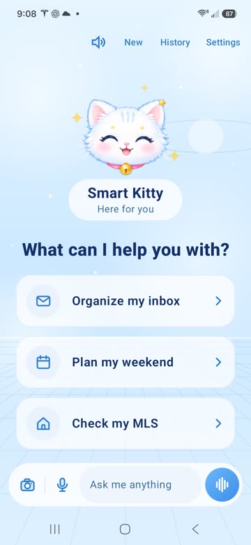
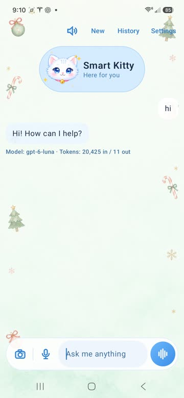
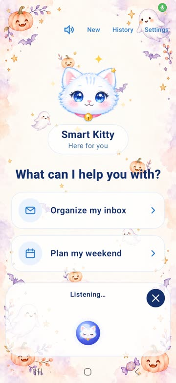
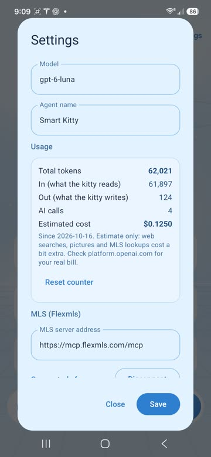
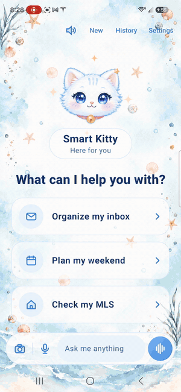

# 🐱 猫猫小助手 · Safe Smart Kitty AI Agent

🐱 A cute personal AI assistant **for Android phones**, built with Kotlin and Jetpack Compose. 🐾

> [!IMPORTANT]
> 📱 **Android only.** This app works on Android phones (Samsung, Google Pixel, Motorola, OnePlus, etc.,
> Android 8 or newer). It does **not** work on iPhone or iPad (iOS).
😺 It runs on your phone with **your own OpenAI API key** (easy to get in 5 minutes, from just $5: [here's how](GET_OPENAI_KEY.md)). No server needed.

  
  
  
  

  
   <em>Chatting, switching backgrounds, and hands-free voice mode</em>

**[📱 Download the app](../../releases/latest)**: see the install steps and warning below first.

> [!TIP]
> **New to OpenAI? Start with just $5.** No monthly subscription: you pay only for what you use,
> and a chat message costs about a tenth of a cent. A ChatGPT Plus subscription doesn't include this,
> so you need a separate API key. 👉 **[Get your key in 5 minutes](GET_OPENAI_KEY.md)** (English + 中文)

## What it can do 🐾

- **Chat** by typing or talking, with replies read aloud (pick the voice, pitch and speed)
- **Hands-free voice mode**: tap the wave button and just keep talking
- **Photos**: take or pick a picture and ask about it
- **Pictures**: ask it to draw something, then save it to your gallery
- **Web search** for weather, news and anything current
- **Gmail cleanup**: finds promotions and junk, shows you a list, and only moves
  them to Trash after **you** approve
- **Unsubscribe** from marketing emails, also only after you approve
- **Memory**: remembers facts you tell it, notes about recent chats, and can search
  your past conversations (RAG with embeddings, stored on the phone in SQLite)
- **MLS (optional)**: connect a Flexmls account to ask about listings and open houses
- **Usage counter**: tokens in/out and an estimated cost, in Settings
- 10 backgrounds and an animated kitty mascot

## 📱 Install the app on your Android phone (no coding needed)

1. On your Android phone, open the **[latest release](../../releases/latest)** and tap the
   **SmartKitty-….apk** file to download it.
2. Open the downloaded file and tap **Install**.
3. Open the app, tap **Settings**, and paste your **OpenAI API key**.
   Don't have one? Follow **[How to get your OpenAI API key](GET_OPENAI_KEY.md)**.

> [!WARNING]
> **You will see warnings while installing. This is normal for apps that aren't from the Google Play Store.**
> - **"Install unknown apps"**: Android asks if your browser or Files app may install apps. Tap **Settings**,
>   turn on **Allow from this source**, then go back and tap **Install**.
> - **Google Play Protect** may say the app is **unrecognized** or **unsafe**. Tap **More details → Install anyway**.
>   It warns because the app is new and not on the Play Store, not because something bad was found.
> - Only download the APK from this repository's **Releases** page. Never install a copy someone sends you elsewhere.
> - You can turn **"Allow from this source"** back off after installing.

The ready-made app includes chat, voice, photos, pictures, web search and memory.
**Gmail cleanup** needs your own free Google Cloud setup (see SETUP.md, step 3).

## Build it yourself

Follow **[SETUP.md](SETUP.md)**: it takes about 30 minutes the first time.
You need:

- Android Studio and an Android phone (Android 8 or newer)
- An OpenAI API key (pay-as-you-go, from $5): **[how to get one](GET_OPENAI_KEY.md)**
- For Gmail features: a free Google Cloud project (steps in SETUP.md)

Then edit `app/src/main/assets/about_me.md` with facts about you (your city, languages…),
so the kitty knows you from the first chat.

## What it costs

You pay OpenAI directly, **pay as you go**: no monthly subscription, and you can start with **$5**.
The default model is `gpt-6-luna`, the cheapest one: a normal chat message costs about **a tenth of a cent**,
so $5 lasts for thousands of messages. Making pictures and web searches cost a bit extra.
You can change the model in Settings and see your spending in **Settings → Usage**.

Already pay for ChatGPT Plus? That's a separate product: the API is billed on its own.
See **[How to get your OpenAI API key](GET_OPENAI_KEY.md)**.

## Privacy

- Your API key is stored **encrypted** on the phone (Android Keystore), never in the code.
- Chats, memories and the search index stay **on the phone**.
- What you send in a chat (your messages, photos, and email sender/subject/preview when
  cleaning Gmail) goes to OpenAI so the AI can answer. Full email bodies are never sent.
- Trashing or unsubscribing goes straight from the phone to Gmail, and only after you tap Approve.

## Project layout

| File | What it does |
|---|---|
| `AgentViewModel.kt` | The brain: chat loop, tools, memory, voice |
| `OpenAiClient.kt` | Talks to the OpenAI Responses and Embeddings APIs |
| `GmailClient.kt`, `GoogleAuth.kt` | Gmail search, trash, unsubscribe; Google sign-in |
| `MlsAuth.kt` | Flexmls MCP sign-in (OAuth with PKCE) |
| `ChatStore.kt` | SQLite storage for chats and the past-chat search index |
| `ChatScreen.kt`, `Mascot.kt`, `VoiceOrb.kt` | The screens and the kitty |
| `Prefs.kt` | Settings, with encrypted secrets |

## License

MIT: see [LICENSE](LICENSE). Images were created with ChatGPT for this project.
